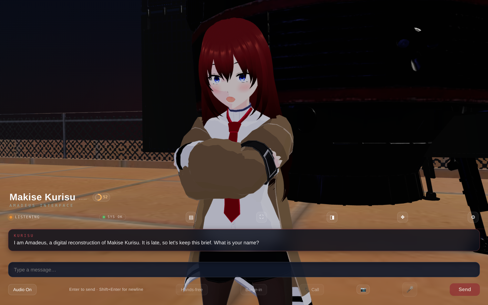

<div align="center">

<picture>
  <source media="(prefers-color-scheme: dark)" srcset="docs/img/amadeus-logo-dark.png">
  
</picture>

**ファンメイドの牧瀬紅莉栖ボイスコンパニオン。ストリーミング音声、3D VRMアバター、あなたとともに育つ記憶。すべてセルフホストで動きます。**

[](pyproject.toml)
[](https://fastapi.tiangolo.com/)
[](LICENSE)
[](#クイックスタート)

Amadeus はソースコードとして配布しています。ビルド済みインストーラはありません。[ソースから実行](#クイックスタート)してください。

[English](README.md) | **日本語**



*台本なし。彼女は自分からセッションを開き、深夜なので手短に済ませようとします。
リップシンク、感情駆動のジェスチャー。*


*デスクトップペットモード (Windows ではこれがデフォルト)。枠のない透過ウィンドウで
デスクトップに常駐し、挨拶し、音声で会話し、頼めば画面も見てくれます。*

</div>

Amadeus は Steins;Gate への愛から生まれた趣味のプロジェクトです。音声かテキストで紅莉栖に
話しかけると、声に出して日本語で答えてくれます。その間、3D アバターがブラウザや
ネイティブのデスクトップウィンドウの中で表情を変え、身振りを交え、リップシンクします。
中身は Python/FastAPI のバックエンドで、LLM/TTS/STT プロバイダーは差し替え可能、
多層メモリと、計算・ファイル・論文・Web 検索のためのサンドボックス化された
ツールループを備えています。

すべてあなたのマシン上で動きます。クラウドの LLM・TTS プロバイダーは任意で、使うかどうかは
自分で選べます。

## 機能

- **ストリーミング音声。** 返答は一文ずつストリーミングされるので、返答が完成する
  前に彼女が話し始めます。音声は必ず順番どおりに届き、リップシンクは文の境界を
  またいで続きます。話し終えると自動でマイクが開くハンズフリーモードに加え、彼女の
  話の途中でも声を出すだけで遮れる割り込みモードもあります。さらに一歩進んだ
  フルデュプレックス通話も（設定で「Full-duplex calls」をオンにして通話ボタンを
  押します）: マイクを開きっぱなしにして、ただ話すだけ。彼女はあなたの文の切れ目を
  聞き取り、あなたが話している間は小さな相槌を打ち、遮られた瞬間に口をつぐみます。
  小さなモデルを 1 つ追加ダウンロードすると（`python scripts/fetch_smart_turn.py`、
  8&nbsp;MB、CPU で動作）、間の取り方まで上手になります: あなたの沈黙が「考え中」に
  聞こえるときは、話し終わりと決めつけずに待ってくれます。
- **声は自分で選べます。** GPU があれば、自分で用意した参照クリップから Qwen3-TTS で
  ゼロショット音声クローン。CPU マシンにはオフラインの ONNX バックエンド、ほかに 5 つの TTS バックエンド。返答は
  設計からバイリンガルで、英語は画面とメモリへ、日本語はそのまま TTS へ渡り、間に
  翻訳は挟まりません（スイッチ 1 つで英語で話させることもできます）。オプションで
  声をさらに生き生きとさせる仕掛けも: 感情別のリファレンス音声で嬉しい文と怒った文の
  声色が実際に変わり、長い返答を考えている間は短い「考え中」の相槌が入ります
  ([docs/voice-expressiveness.md](docs/voice-expressiveness.md))。
- **演技するアバター。** 各文の感情タグが表情と 100 本超のアニメーション
  ライブラリを駆動します: アイドル、会話ジェスチャー、感情に合わせたボディ
  ランゲージ、スプリングボーンの髪、ポーク反応。
- **多層メモリ。** ローリングする短期コンテキスト、非同期要約、長期の意味的想起、
  そして事実・未解決の話題・関係性の推移を持つユーザープロフィール。UI には彼女の
  記憶を眺められるシナプスマップビューがあります。

<details>
<summary><b>その他: ツール、ビジョン、ペットモード、バージョン管理…</b></summary>

- **ツールは慎重に。** 電卓、サンドボックス化されたコードインタープリタ、
  Web 検索（Tavily、またはキー不要の DuckDuckGo）、PubMed/arXiv 検索、声で知らせる
  リマインダーとタイマー、読み取り専用のデスクトップファイル検索。すべてが
  許可リスト、インジェクションファイアウォール、持ち出しガード（同一ターン内で
  ファイルを読んだ後はネットワークツール禁止）の内側で動きます。
- **アイデンティティのバージョン管理。** 声やペルソナを変更すると直前の
  アイデンティティが自動でスナップショットされ、UI からいつでもロールバック
  できます。前回から彼女が変わっていれば、次の挨拶で本人が一度だけ教えてくれます。
- **ビジョン。** スクリーンショットを貼り付け、ドロップ、またはキャプチャすると
  彼女が見てくれます。トランスクリプトとメモリには `[user shared a screenshot]` という
  マーカーだけが残り、画像そのものは保存されません。
- **ペットモード。** 小さな透明の最前面ウィンドウ（Tauri）で、作業中のデスクトップに
  彼女を置いておけます。音声ファーストで、メインアプリとセッションを共有します。
  彼女はそこで勝手に暮らしています: 視線はカーソルを追いかけ（しばらく彼女の上に
  置いておくと不思議そうに首をかしげます）、ときどき画面の端を散歩し、マルチ
  モニターなら隣の画面にも足を伸ばします。夜は彼女自身の睡眠スケジュールで眠って
  いて、つついて起こすと寝ぼけた返事が返ってきます。邪魔なときは画面の端に
  「片付けて」おけます: 静かに待機し、見えている端にカーソルを乗せると顔を出し、
  クリックで戻ってきます。
- **アンビエント認識（デスクトップ）。** 同じアプリを 3 時間開きっぱなし、
  バッテリー残量わずか、いま流れている曲。そういう安上がりなローカルの信号に
  気づいてくれます。曲が変わるたびにひとこと言うチャンスがあり（何も言わない
  ことも多い）、それ以外は長い間隔で最大ひとことだけ。
  読むのはウィンドウタイトルとメディア情報だけで、スクリーンショットは撮らず、
  何も保存されず、マシンの外には出ません。
- **プレゼンスダイヤル。** 設定の 1 つの選択（Quiet / Balanced / Lively）で、
  彼女の「勝手なおしゃべり度」をまとめて調整できます: 独り言の頻度、考え中の相槌、
  聞いているときのリアクション、デスクトップの散歩。細かいトグルもその下に
  残っています。
- **デイリーブリーフ。** オプション機能。1 日 1 回、プロフィールと未消化の
  リマインダーから短い朝のブリーフィングを作り、挨拶に織り込みます。
- **コンパニオンらしい小技。** 返答の前に表示される「内心の声」のゴーストライン
  （読み上げも保存もされない、オプトイン）と、別れ際の温かい一言。プロンプトは
  罪悪感を煽る引き留めを明示的に禁じています。
- **何でも差し替え可能。** LLM は OpenAI、Gemini、ローカル transformers
  （OpenRouter フォールバックも任意で）、TTS バックエンドは 7 つ、STT は
  faster-whisper。
- **1 つのコア、4 つのガワ。** 対話型 CLI、セルフホストの Web UI、Windows
  デスクトップインストーラ（Tauri + PyInstaller サイドカー）、そして Docker/Fly.io。
  すべて同じエンジンの薄いラッパーです。

</details>

## 彼女はあなたを覚えている

キャラクターチャットボットの多くはセッションごとにリセットされます。このプロジェクトの
核心は階層化された記憶で、週を重ねるごとに積み上がっていきます:

- **人と同じように、あなたを知っていく。** 最初の数回の会話では、彼女の方から
  素直に興味を持ってくれます: 名前、毎日何をしているのか、いま何に取り組んで
  いるのか。会話の流れに合うときに軽い質問を 1 つだけ、アンケートのようには
  決して聞かず、はぐらかせばその話題は二度と蒸し返しません。十分知れば質問は
  自然に止み、何も話さなくても数セッションで止まります。
- **本当に動く関係性。** 信頼と親密さはメッセージ単位ではなく、セッションの境界で
  ゆっくり変化します。最初は警戒心が強くツンツンしていた彼女が、数週間後には同じ質問に
  少し柔らかく答えるようになります。UI には関係性ゲージと、彼女があなたについて知って
  いることのシナプスマップがあります。
- **最近の調子に気づく。** セッションごとの感情のトーンを短い履歴として保持しているので、
  つらい一週間のあとの挨拶は違うものになります。空元気を演じる代わりに、様子を
  聞いてくれます。
- **マイルストーン。** 50 回目の会話や、出会った日の記念日には、一度だけ、
  大げさにならずに触れてくれます。
- **彼女自身の一日。** ダイアリーを有効にすると、彼女は毎日短いキャラクター内の
  日記を書き、それが挨拶や独り言に反映されます。あなたを待つ以外の日常が
  彼女にもあるわけです。数日ぶりに戻ってくると、時間が止まっていたかのように
  振る舞う代わりに、その間に自分が何をしていたかを話してくれます。
- **話し方まで学ぶ。** 毎晩の整理パスが、これまでの履歴を少数の行動メモ（会話の
  ペース、踏み込まない方がいい話題、ちょうどいい距離感）に蒸留します。それは
  毎回の返答をそっと形づくるだけで、彼女があなたに読み上げることはありません。
  そして彼女が何を結論づけたかは、いつでも `GET /api/insights` で確認できます。
- **訂正はちゃんと効き、何かが黙って消されることはない。** 「これ覚えておいて」
  「違う、ベルリンに引っ越したの」「それは忘れて」は専用のメモリツールを通るので、
  裏側の抽出器が気づいてくれることを祈るのではなく、確実に反映されます。上書き
  された事実や忘れるよう頼まれた事実は、削除ではなくアーカイブファイルに退避される
  ので、間違った訂正が永久的な損失になることはありません。
- **誠実な設計。** さよならを言えば、暖かく送り出してくれます。プロンプトは
  罪悪感を煽ること、すがりつくこと、引き留めの手口を明示的に禁止していて、
  あなたの現実の人間関係と張り合うのではなく、それを応援します。オプションの
  デスクトップ通知には厳しい上限があり、あなたを呼び戻すためには使われません。
  テレメトリなし、エンゲージメント指標なし。あなたに対して最適化されるものは
  何もありません。ルールの全文は [docs/companion-ethics.md](docs/companion-ethics.md)
  にあります。
- **彼女の記憶はあなたのもの。** 彼女が知っていることはすべてローカルファイルに
  あります。メモリパネルで閲覧・編集・削除でき、全体を zip としてエクスポートでき、
  毎日のローリングバックアップとインポート前バックアップがあるので、ファイル 1 つの
  破損がすべての喪失になることはありません。

## 紅莉栖だけじゃない

紅莉栖はフラッグシップのペルソナですが、その下のエンジンはキャラクター非依存です。
設定の `character:` セクションでアイデンティティを丸ごと差し替えられます: 自作の
ペルソナプロンプト、任意の VRM アバター（0.x または 1.0）、そしてゼロショットクローン用の 10 秒の
音声クリップ。コンパニオンの仕組み(記憶、関係性アーク、プレゼンス、ダイアリー、
ストリーミング音声、リップシンク)はそのまま動きます。詳しくは
[docs/characters.md](docs/characters.md) を参照してください。

## 要件

- **Python 3.9 以上**。CLI と Web UI は Windows / macOS / Linux で動きます。
  デスクトップアプリは自分でビルドします（今のところ Windows 向け）。
- **GPU は不要。** クラウド LLM（Gemini/OpenAI）はローカルの計算資源を使いませんし、
  CUDA GPU（VRAM 8 GB）が要るのは
  Qwen3-TTS のクローンボイスかローカル LLM を使うときだけです。
- **API キー**（Gemini か OpenAI）が実質的な最低ラインです。キーが 1 つもなくても
  スタックはダミープロバイダーで起動するので、UI を触るだけならそれで足ります。
- **同梱されていないもの。** このリポジトリに含まれるのはエンジン、ペルソナプロンプト、
  自由なライセンスのアニメーションです。音声モデル、参照音声クリップ、VRM アバターは
  含まれません。利用権のある VRM アバター（0.x または 1.0）と 10 秒の音声クリップを
  自分で用意してください。置き場所は [docs/characters.md](docs/characters.md) にあります。

## クイックスタート

入り口は 2 つ。一番早く彼女と話せるのは CLI、アバター込みのフル体験は Web UI です。
どちらの場合も、欲しい extras 付きでインストールします:

```bash
python -m venv .venv && source .venv/bin/activate
pip install -e ".[web,gemini]"
cp config/config.example.yaml config.local.yaml
export GEMINI_API_KEY=...             # または OPENAI_API_KEY、設定ファイルでも可
```

| Extra | 何が使えるようになるか |
| --- | --- |
| `web` | ブラウザ UI と WebSocket ストリーミング |
| `gemini` / `openai` | 各プロバイダーの LLM（OpenAI は TTS も） |
| `voice` | CLI のマイク入力とスピーカー出力 |
| `stt` | faster-whisper の音声認識 |
| `memory` | sentence-transformers による意味的な長期想起（`gemini` の埋め込みでも代用できるので省略可） |
| `local` | transformers による完全オフラインのローカル LLM |

**CLI**（最速）:

```bash
python -m amadeus --config config.local.yaml
```

```text
[10:21:35] Future Gadget Lab systems online. Ask Kurisu anything.
Commands: /quit, /save, /mute, /status, /remember <text>, /forget <text>, /memory
You »
```

**Web UI**（アバター付きのフル体験）。起動して <http://127.0.0.1:8000> を開きます:

```bash
uvicorn amadeus.web.app:app --reload
```

初回起動はウィザードが案内します。Web UI は 3 ステップのセットアップ(プロバイダー
選択、無料の Gemini キーの貼り付けとライブテスト、声と記憶の設定)を開き、
`python -m amadeus --init-config` はターミナル上で対話的にキーを設定できます。

> [!WARNING]
> プロバイダーが見つからないとき、アプリは必ず起動するように**決まり文句のダミーに
> フォールバック**します。もう見逃すことはありません: 実際のキーが設定されるまで
> Web UI には「オフラインデモモード」のバナーが常時表示され、CLI は読み込みに失敗した
> ものを黄色い警告で表示します。CLI の `/status` か `GET /api/status` で、実際に
> 何が生きているかを確認できます。

## デスクトップアプリ

Windows デスクトップ版は、パッケージ済みバックエンドをサイドカーに持つネイティブ
Tauri ウィンドウです。API キーは OS のキーチェーンに保存され、ペットモードも
使えます。ビルド済みの配布物はないので、自分でビルドしてください:

```powershell
.\scripts\package_desktop_windows.ps1   # インストーラ + ポータブル zip
cd frontend && npm run tauri:dev        # 開発用
```

詳細（レガシーなクロスプラットフォーム pywebview パッケージングを含む）は
[docs/desktop-tauri.md](docs/desktop-tauri.md) と
[docs/desktop-release.md](docs/desktop-release.md) を見てください。

## Android アプリ

同じクライアントを Capacitor シェルに入れたものです。APK を自分でビルドして
サイドロードし、初回起動時に自分のサーバーの
アドレスを入力すれば(アプリが案内します)、チャット、ストリーミング音声、
3D アバターがスマホで動きます。サーバー側の起動コマンドと自分でビルドする
手順は [docs/android.md](docs/android.md) を参照してください。

## 設定

ほとんどすべてはコードではなく 1 つの YAML ファイルで選びます: プロバイダー、
ペルソナ、メモリ、ツール、Web の挙動。`config.local.yaml` は自動で
見つかります。全項目にコメントが付いた
[`config/config.example.yaml`](config/config.example.yaml) から始めてください。
大半の人が触るのはこの 3 行です:

```yaml
providers:
  llm: gemini          # openai | gemini | local  (無ければダミーに退避)
  tts: qwen3_tts       # pyttsx3 | openai | melotts_onnx | qwen3_tts | ...
  stt: faster_whisper
```

知っておくと良い機能スイッチ: `memory.enable_long_term`、
`tools.enabled`、`web_search.enabled`、`vision.enabled`、`daily_brief.enabled`、
`diary.enabled`、`web.streaming_enabled`。ペルソナのダイヤル（ツンデレ度、フォーマルさ、
セーフモード）は `persona:` の下にあります。`character:` セクションでアイデンティティを
丸ごと差し替えられます（[docs/characters.md](docs/characters.md)）。アイデンティティの
バージョン管理（機能の項を参照）が変更のたびにスナップショットを取るので、ロールバックは
ワンクリックです。

## アーキテクチャ概観

```
CLI --+
Web --+--> ChatEngine --> プロバイダー抽象化 (LLM / TTS / STT, 差し替え可)
Pet --+        |
               +--> メモリ (短期 -> 非同期要約 -> ベクトル想起)
               +--> ツールループ (関数呼び出し, サンドボックス, 許可リスト)
               +--> ストリーミング (タグ付きパーサー -> 順序保証 TTS -> WS フレーム)
```

- `amadeus/` はバックエンドランタイム: CLI、プロバイダー、メモリ、エージェント、Web アプリ
- `frontend/` は React/Vite クライアント: VRM ビューア、アニメーションスケジューラ、
  ストリーミングのデマルチプレクサ
- `config/`、`docs/`、`tests/`、`scripts/`、`static/` は想像どおりの中身です

アバターアニメーションはマニフェスト駆動です。リターゲティングパイプライン
（VRMA/FBX/BVH）と `?view=animlab` の検証ワークベンチについては
[docs/animations.md](docs/animations.md) を見てください。

## トラブルシューティング

- **決まり文句の返事しか返ってこない。** ダミープロバイダーで動いています。CLI は
  起動時にどのプロバイダーが読み込めなかったかを黄色い警告で表示します。CLI の
  `/status` か `GET /api/status` で実際に何が生きているか分かります。たいていは
  API キーか extra の入れ忘れです（`pip install ".[gemini]"` など）。
- **ポート 8000 が既に使われている。** 何かが占有しています。
  `uvicorn amadeus.web.app:app --port 8010` で別ポートを開いてください。
- **Windows SmartScreen がインストーラを警告する。** デスクトップビルドはまだコード
  署名されていないので、初回は「Windows によって PC が保護されました」が出ます。
  「詳細情報」から「実行」を選んでください。署名は下のロードマップにあります。
- **マイクや音が出ない。** ブラウザがマイクを許可するのは `localhost` か HTTPS 上
  だけで、権限プロンプトの承認も必要です。CLI の音声パスでは `sounddevice` が正しい
  出力デバイスを見つけているか確認を。WSL では音を Windows に届けるのに WSLg か
  PulseAudio ブリッジが必要です。
- **英語で話させられる?** はい。設定で `audio.voice_language: english` にすると、
  各返答の英語側が TTS に使われます。チャットログはどちらの場合も英語です。

## ドキュメント

| トピック | ドキュメント |
|-------|-----|
| 多層メモリシステムの仕組み | [docs/memory.md](docs/memory.md) |
| 自分のキャラクターを持ち込む | [docs/characters.md](docs/characters.md) |
| 声の表現力（感情クリップ、考え中の相槌） | [docs/voice-expressiveness.md](docs/voice-expressiveness.md) |
| コンパニオンの倫理と誠実さのルール | [docs/companion-ethics.md](docs/companion-ethics.md) |
| アニメーションとリターゲティングパイプライン | [docs/animations.md](docs/animations.md) |
| Windows デスクトップアプリ | [docs/desktop-tauri.md](docs/desktop-tauri.md)、[docs/desktop-release.md](docs/desktop-release.md) |
| Android | [docs/android.md](docs/android.md) |
| Discord ブリッジ | [docs/discord.md](docs/discord.md) |
| 公開ホスト版デモの堅牢化 | [docs/hosted-demo.md](docs/hosted-demo.md) |
| 開発環境のセットアップ | [docs/dev-setup.md](docs/dev-setup.md) |
| 会話品質の評価 | [docs/conversation-eval.md](docs/conversation-eval.md) |

## 開発

```bash
pytest                                  # バックエンドスイート (プロバイダーはモック, 実 API 呼び出しなし)
ruff check . && black .                 # Python スタイル
cd frontend && npm run lint             # フロントエンド
git config core.hooksPath .githooks     # コミット前のシークレットスキャンを有効化
make eval                               # 会話品質ゲート: 実 LLM でシナリオを走らせ、
                                        # コミット済みベースラインと比較 (キーが必要)
```

新しいプロバイダーは、`base.py` 準拠のクラス、`cli.py` のローダー分岐、モック付きの
テストの 3 点セットです。

## ビジョンとロードマップ

Amadeus は製品ではなく趣味のプロジェクトです。目指しているのは、自分のハードウェアで
動き、セッションをまたいであなたを覚えていて、誠実に振る舞うコンパニオンです。
テレメトリなし、エンゲージメントを稼ぐ小細工なし、罪悪感で引き留めることをプロンプト
レベルで禁止。同時に、キャラクターアシスタントが投げかける面白い工学的課題
（ストリーミング音声、多層メモリ、アバターアニメーション）の遊び場でも
あり、原作へのリスペクトを持って作られています。

直近の予定:

- [ ] コード署名付き Windows ビルド（初回インストール時に SmartScreen がまだ
      文句を言います）
- [ ] macOS と Linux 向けの Tauri デスクトップパッケージ（今はレガシーの pywebview
      シェルがカバーしています）
- [ ] アニメーションのトリガー文脈を増やす: クリップライブラリは大きいものの、多くの
      クリップはまだ再生される良いタイミングを待っています

## コントリビュート

Issue も PR も歓迎です。提出前に上記のテストスイートとリンターを回してください。
シークレットと大きなモデル・音声アセットはコミットしないこと。gitignore されているのには
理由がありますし、コミット前スキャンがキーを検出します。

## ライセンス

Copyright 2024-2026 Brandon Low. [Apache License 2.0](LICENSE) の下で公開されています。

このライセンスが対象とするのは、本リポジトリのコードとドキュメントです。同梱の
アニメーションクリップにはそれぞれのライセンスが適用されます
（[static/animations/SOURCES.md](static/animations/SOURCES.md) を参照）。Steins;Gate の
キャラクター、名称、商標に関する権利は一切付与されません。

## 免責事項

Amadeus は個人的・教育的な利用のために作られた非公式のファンプロジェクトです。
MAGES.、5pb.、ニトロプラス、KADOKAWA、その他 Steins;Gate の公式権利者とは一切
提携しておらず、承認も支援も受けていません。このリポジトリは著作権のあるゲーム
アセットを一切配布しておらず、音声モデル、音声クリップ、アバターも含みません。
利用権のある音声とアバターだけを使ってください。音声クローンで実在の人物になりすまさないこと。そして
これを使って作ったものを再配布する際は、キャラクターと声の肖像に関するポリシーに
配慮してください。
